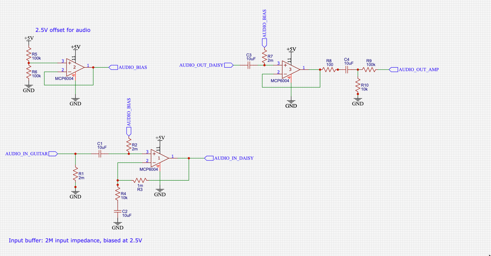
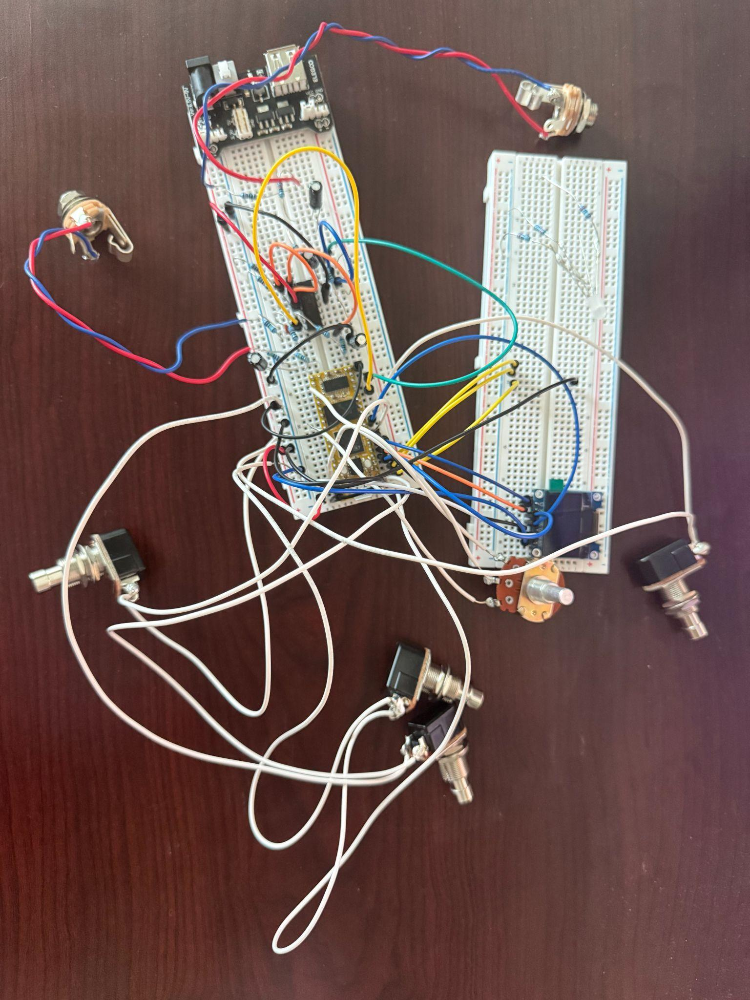
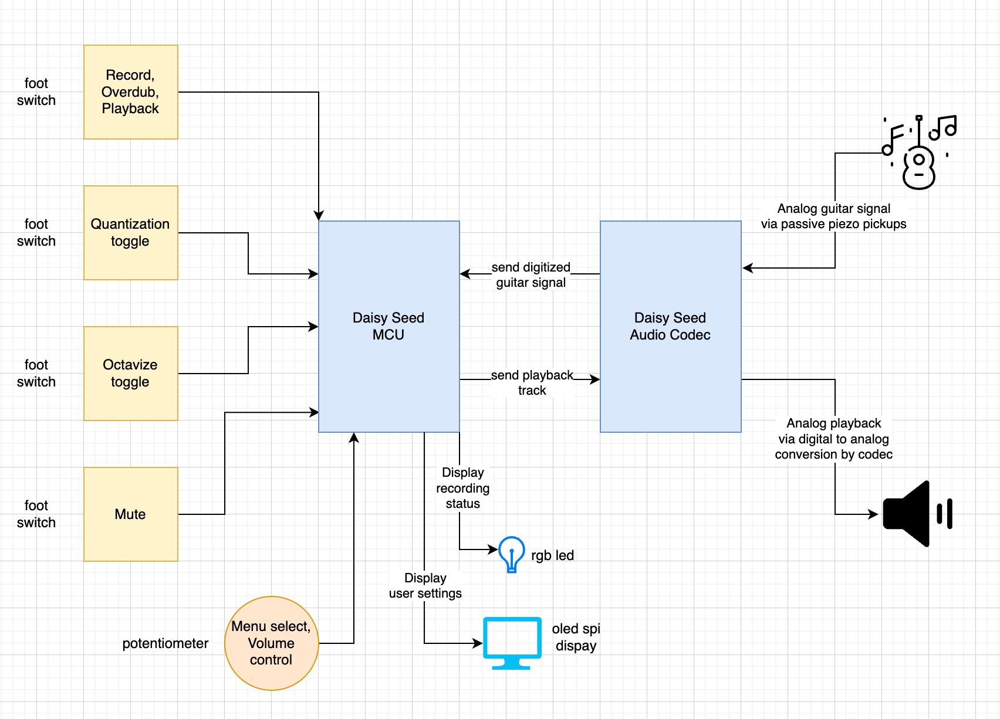

# Guitar Looper Pedal

A Daisy Seed guitar looper with custom analog circuitry, footswitch controls, and an OLED interface. Record a loop, layer overdubs, and play with tempo quantization and an octave effect.

## The idea

This project was inspired by Ed Sheeran’s live looping. I wanted to build a pedal with features like quantization to make looping easier to use as getting the timing right without it can be frustrating, especially when a slightly mistimed loop keeps repeating. The design centers on one master loop with overdubbing and footswitch controls.

## Features

- Record and play back a master loop of approximately 30 seconds.
- Add successive overdubs, with a decay factor to manage accumulated levels.
- Smooth loop boundaries with a short crossfade.
- Quantize recording to a tempo, with adjustable BPM, time signatures, and a count-in.
- Toggle an octave effect and mute from footswitches.
- View loop state and settings on an OLED, with an RGB LED for quick feedback.

## Hardware

| Component | Purpose |
| --- | --- |
| Daisy Seed | Real-time audio processing and audio conversion |
| MCP6004 op-amp circuitry | Guitar input conditioning, biasing, gain, and output buffering |
| Four SPST footswitches | Looping, quantization, octave effect, and mute |
| Rotary potentiometer | Loop volume and settings navigation |
| SPI OLED display | Loop state, length, and settings |
| RGB LED | State feedback |
| 1/4-inch audio jacks | Guitar input and amplifier output |

### Analog signal path

The analog front-end was a substantial part of the build. A buffered resistor divider creates a 2.5 V bias reference; the input stage provides high input impedance and gain before the signal reaches the Daisy Seed. The output stage buffers, AC-couples, and attenuates the processed signal for the amplifier.



Component choices and gain changed during development; this schematic captures the analog design.

<p align="center">
  
</p>

### System overview



## Firmware

The C++ firmware in [`src/main.cpp`](src/main.cpp) handles audio processing, the looper state machine, footswitch gestures, and display and LED feedback. It includes a 60 Hz notch filter, an octave-down effect, and SDRAM buffers for the loop and one-level undo.

See [LOOPER.md](LOOPER.md) for the full control guide and pin assignments.

### Build and flash

Install an Arm embedded GCC toolchain, Make, and `dfu-util`. The Makefile expects **libDaisy** and **DaisySP** in the project root. Fetch the library revisions used by the original code:

```bash
git clone https://github.com/electro-smith/libDaisy.git libDaisy
git -C libDaisy checkout 08f29653610c08cdf1ca7b5cfcac3bb4922e60c4
git -C libDaisy submodule update --init --recursive
git clone https://github.com/electro-smith/DaisySP.git DaisySP
git -C DaisySP checkout 599511b740f8f3a9b8db72a0642aa45b8a23c3a3
git -C DaisySP submodule update --init --recursive
make -C libDaisy
make -C DaisySP
make
```

With the Seed connected over USB, hold **BOOT**, tap **RESET**, and release **BOOT** to enter DFU mode. Run `make program-dfu`, then tap **RESET** to start the firmware.

### Repository contents

- `src/main.cpp` — looper transitions, audio callback, and application entry point.
- `src/biquad_notch.h` and `src/octave_down.h` — audio effects.
- `src/metronome.*` and `src/timing.h` — metronome and time signature helpers.
- `src/controls.*` — footswitch gestures and quantization menu controls.
- `src/ui.*` — OLED rendering, LED feedback, and potentiometer handling.
- `src/hardware.*` — Daisy Seed and peripheral setup.
- `src/pedal_state.*` — shared state, settings, and SDRAM buffers.
- `LOOPER.md` — wiring, controls, and firmware details.
- `tools/` — recording capture and noise analysis scripts.
- `docs/images/` — prototype photos, analog schematic, and system diagram.
- `*.STL` and `*.gcode` — mechanical design and printing files.

## Development notes

Getting a clean analog signal was the main hardware challenge. Development started with audio passthrough, then added recording, playback, overdubbing, controls, and the display. Gain staging, decoupling, and shorter wiring helped manage noise. After problems with a soldered protoboard, the final working setup returned to breadboards for easier debugging.
